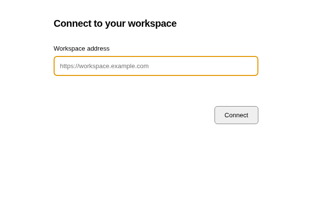

# Self-hosted desktop

Feature: `selfHostedDesktop`. Deployment: `self_hosted`. Author: `FreedomLovesYou`.

This fork adds an opt-in **OpenWork Remote** Mac desktop distribution. It displays
the self-hosted OpenWork web client in an isolated Electron window. Tasks, files,
history, model configuration and tools stay on the server. It is not a native
local/remote workspace sync implementation. Mac file access, native dictation,
computer control, cloud OAuth popups and upstream auto-updates are not provided.
The existing local desktop distribution is unchanged.

The registry default is off. This distribution applies a self-hosted operator lock
through `resolveFeature`; `enabled: false` in its local `connection.json` turns
remote access off on next launch. That preserves server tasks, data and history.
The standalone client does not fetch Den rollout policy; this lock is local.

## Install

Run **Build self-hosted Mac desktop** in this fork's GitHub Actions, or push this
branch. Download the artifact matching Apple Silicon (`arm64`) or Intel (`x64`).
Open the DMG and copy OpenWork Remote to Applications. These personal builds are
unsigned and not notarized; macOS may require its Privacy & Security **Open Anyway**
flow. There is no Apple signing identity in this repository.

Start your VPN, open the app, and enter your self-hosted web workspace URL.
The web UI and its API/websocket proxy must share one origin. HTTPS is preferred;
HTTP is accepted only for literal private/VPN or loopback addresses.
No credentials, infrastructure addresses or model keys are shipped in the app.
Authentication is handled by the self-hosted web client. Model requests run on
the server, using the provider configuration already installed there.

Use **OpenWork Remote → Connect to workspace…** to change servers, or **Reconnect**
after a network interruption. Settings live in
`~/Library/Application Support/OpenWork Remote/connection.json`.

The renderer has no Node access or native preload. Only the local connection
window can change settings. Network requests and navigation are limited to the
configured origin; third-party/cloud embeds and OAuth popups will not work.
This desktop network policy does not change the server's outbound integrations.
The server must separately be configured if no cloud traffic is required there.

## Local validation and build

Requires Node 24 and pnpm 11.4.0; packaging a DMG requires macOS.

```sh
node --test apps/desktop/test/remote-desktop.test.mjs
node apps/desktop/scripts/prepare-remote-desktop.mjs /tmp/openwork-remote-build
cd /tmp/openwork-remote-build
pnpm install --frozen-lockfile
pnpm exec install-electron
pnpm start
pnpm exec electron-builder --mac --arm64 --publish never
```

Connection UI uses a native HTML form because this separately packaged shell
does not include the React renderer or its component library (DESIGN P5).
It follows P2, P3, C1 and C6: one title, one address field, direct connection
action, and an actionable offline error. The task UI is the existing server UI.



